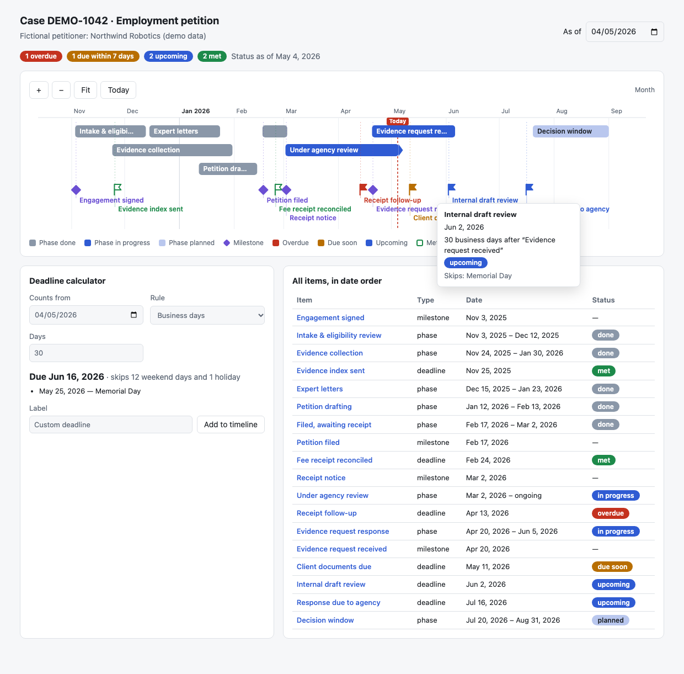
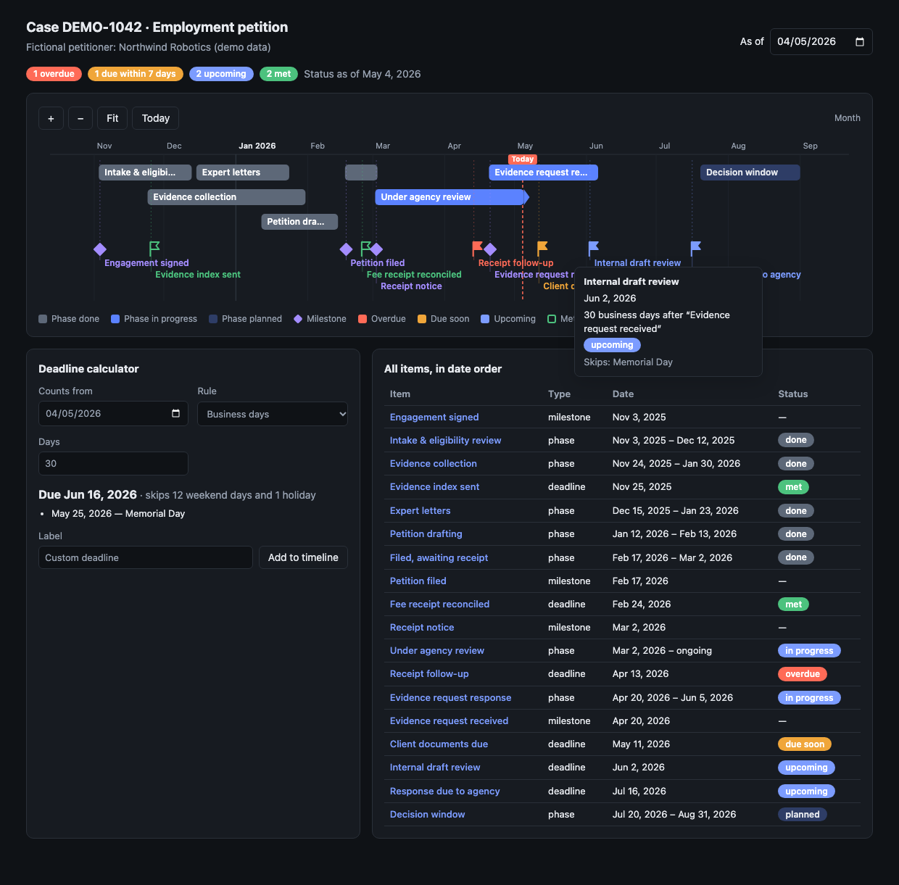
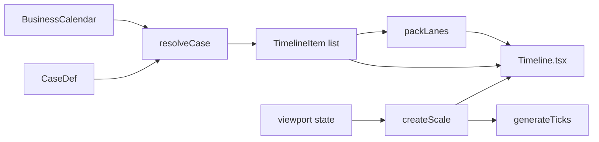

# caseflow-timeline

[](https://github.com/hdamasceno/caseflow-timeline/actions/workflows/ci.yml)


An interactive **SVG timeline** for a legal case's lifecycle, plus a **deadline engine** that counts
business days around weekends and US federal holidays. React 19 + TypeScript, and **no chart
library**: the scale, ticks, lane layout, zoom and pan are written from scratch as small pure
functions with unit tests.



<details>
<summary>Dark mode</summary>



</details>

> All data is invented. "Case DEMO-1042" and "Northwind Robotics" are fictional.

## Why it is interesting

- **Hand-built SVG rendering.** A linear time scale maps day numbers to pixels; tick marks snap
  to calendar boundaries (Monday weeks, month starts, quarters, years), and the unit is picked
  from the current pixels-per-day so labels never crowd.
- **Optimal lane packing.** Overlapping phases are stacked with first-fit in start order, which is
  optimal for interval graphs. A randomized test checks that the lane count always equals the
  maximum overlap. The same packer runs in pixel space to keep marker labels from colliding at any
  zoom.
- **Anchored zoom.** The wheel zooms around the cursor (the day under the pointer stays put),
  a horizontal wheel or trackpad pans, dragging pans, and a drag never counts as a click.
- **Deadlines that are right on real calendars.** Federal holidays are computed for any year, with
  Saturday holidays observed on Friday and Sunday ones on Monday, including the case where
  New Year's Day is observed on December 31 of the year before. Rules can be
  "N business days" or "N calendar days, moved to the next business day".
- **Accessible by design.** Items use a roving tabindex (one tab stop, arrow keys to move,
  Home/End, Enter to select, +/- to zoom, 0 to fit). The tooltip is linked with
  `aria-describedby`, every item has a full spoken description, and a linked table gives a
  non-visual view of the same data. Status is never shown by colour alone.
- **No time-zone bugs.** Dates are `YYYY-MM-DD` strings and integer UTC day numbers, so
  daylight-saving changes cannot shift a deadline.

## Architecture

```
src/
├── lib/                  pure, framework-free, 100% line coverage
│   ├── date.ts           ISO dates <-> UTC day numbers, weekdays, nth weekday of month
│   ├── holidays.ts       federal holidays per year + BusinessCalendar (weekends, holidays, closures)
│   ├── deadlines.ts      computeDeadline(start, rule, calendar), deadlineStatus()
│   ├── scale.ts          createScale(), chooseTickUnit(), generateTicks()
│   ├── layout.ts         packLanes() and maxOverlap() for intervals
│   ├── viewport.ts       zoomAt(), panBy(), reveal(), clampViewport()
│   └── text.ts           label width estimate and ellipsis fitting
├── model/
│   ├── case.ts           CaseDef -> resolved TimelineItems (dates, statuses, descriptions)
│   └── demoCase.ts       invented demo data
└── components/
    ├── Timeline.tsx      the SVG view: axis, grid, bars, markers, tooltip, input handling
    ├── DeadlineCalculator.tsx
    └── ItemTable.tsx
```

The component is a thin layer: it keeps the viewport in state and asks `lib/` for everything else.
That split is what makes the hard parts testable without a browser.



## Run it

Requires Node 20.19+ (CI uses Node 22).

```bash
npm install
npm run dev
```

Open the printed URL. Add `?today=2026-05-04` to pin the "as of" date, or change it in the header.

## Test it

| Command | What it runs |
| --- | --- |
| `npm run lint` | oxlint, warnings fail the build |
| `npm run typecheck` | `tsc -b` with `strict`, `noUncheckedIndexedAccess`, `exactOptionalPropertyTypes` |
| `npm test` | 82 Vitest unit and component tests (jsdom + Testing Library) |
| `npm run coverage` | the same, with a V8 coverage report |
| `npm run test:e2e` | 6 Playwright tests against the production build (wheel zoom, drag, keyboard, resize) |
| `npm run screenshots` | regenerates the images in `docs/` |
| `npm run check:secrets` | secret scan of the staged files (`-- --all` for every tracked file) |
| `npm run test:hooks` | tests for the secret scanner (`node --test`) |

CI runs a secret scan, lint, typecheck, unit tests with coverage, and then Playwright on every push and pull
request.

### Git hooks

`npm install` sets up [Husky](https://typicode.github.io/husky/) hooks, so the checks CI runs
also run locally, before anything leaves your machine:

| Hook | Runs | Why |
| --- | --- | --- |
| `pre-commit` | secret scan, then lint, then typecheck | stop private keys, tokens and `.env` files before they are in history |
| `pre-push` | unit and component tests (Vitest), then Playwright end-to-end tests | do not push a branch that CI will reject |

The secret scan (`scripts/check-secrets.mjs`, no dependencies) blocks `.env` files (except
`.env.example`), key and certificate files (`.pem`, `.key`, `.p8`, `.p12`, `.jks`, SSH keys), and
content that looks like a private key, cloud or API token, or a connection string with a password
for a non-local host. It only reads the staged version of each file and never prints the value it
found. If [gitleaks](https://github.com/gitleaks/gitleaks) is installed it runs too, as a second
opinion. A false positive can be allowed with a `secret-scan: allow` comment on that line.

In an emergency `git commit --no-verify` skips the hooks; CI still runs the same secret scan, plus
gitleaks over the full history, on every push and pull request.

## Keyboard

| Key | Action |
| --- | --- |
| Tab | Move into the timeline (one tab stop) |
| ← / → | Previous / next item, scrolling it into view |
| Home / End | First / last item |
| Shift + ← / → | Pan |
| + / − | Zoom around the focused item |
| 0 | Fit everything |
| Enter / Space | Select the item (highlights its table row) |

## Not included, on purpose

- No backend: the case is static demo data, so the project stays about the interface.
- State and local holidays are not modelled; `BusinessCalendar` accepts extra closure dates instead.
- Label widths are estimated rather than measured, so packing also works in jsdom tests.

## License

[MIT](LICENSE) © Henry Lima
